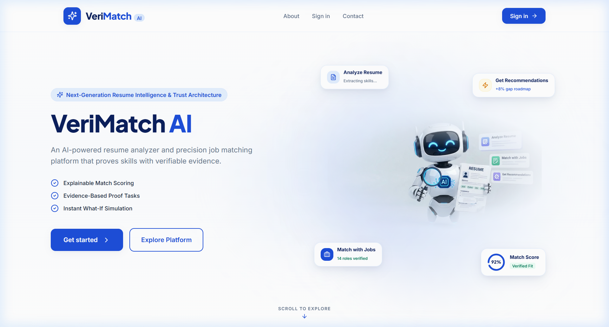
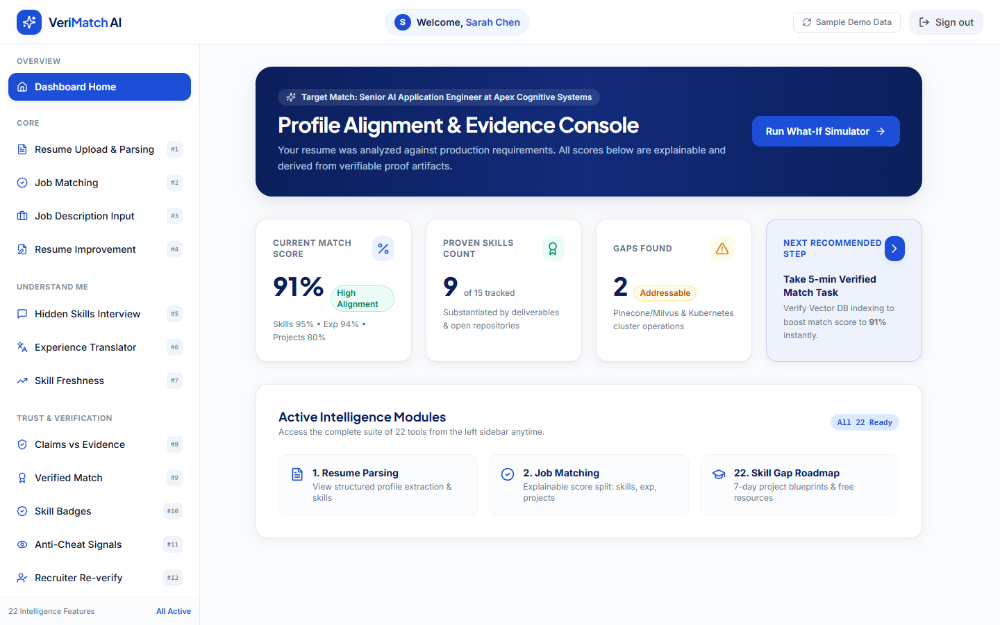
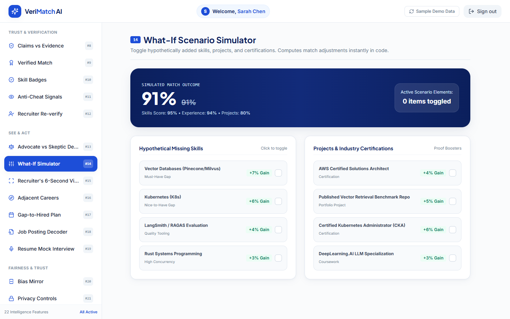
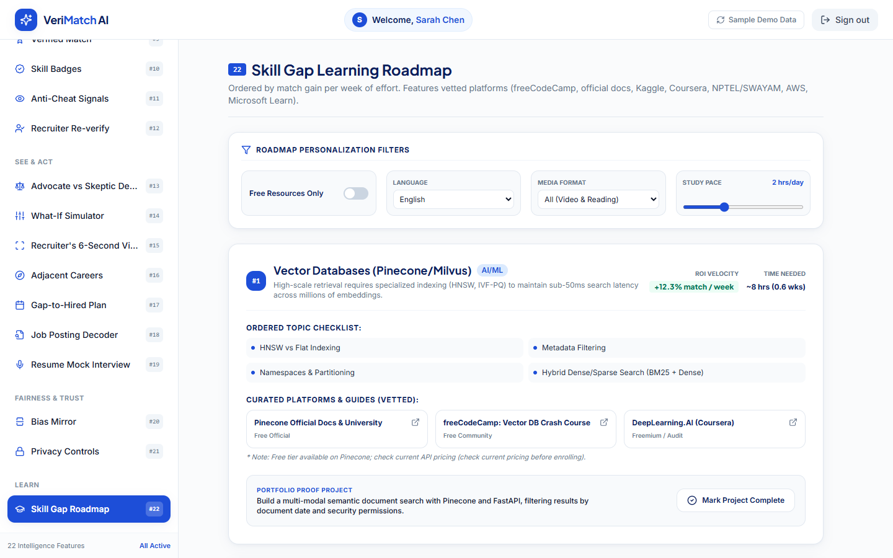
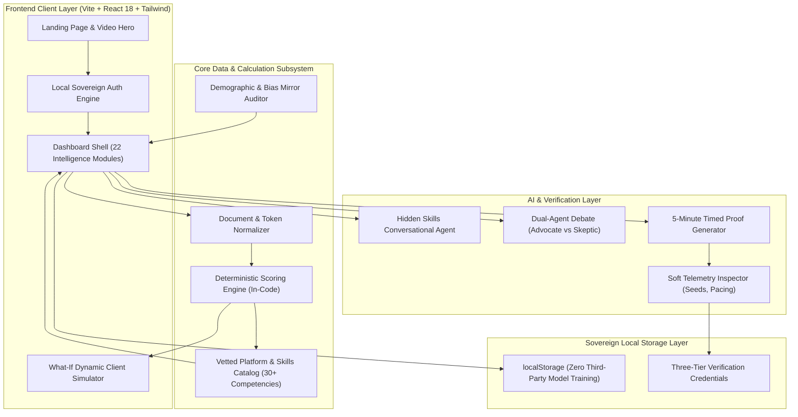
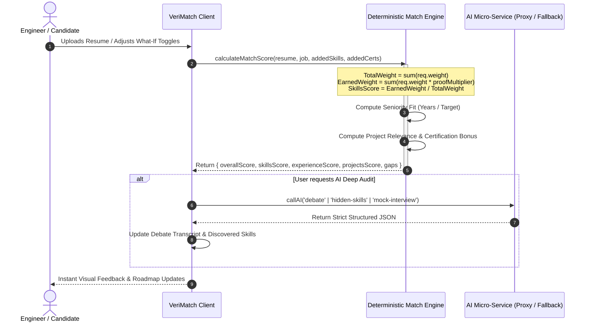

# VeriMatch AI — AI-Powered Resume Analyzer & Precision Job Matching Platform

[](https://github.com/krithika2006-hue)
[](https://vitejs.dev/)
[](https://react.dev/)
[](https://tailwindcss.com/)
[](LICENSE)

An enterprise-grade, explainable AI platform bridging the trust gap between software engineers and hiring teams. Built with verifiable evidence grounding, three-tier cryptographic skill badges, real-time What-If scenario simulations, and actionable 7-day micro learning roadmaps.

---

## 📸 Platform Visual Showcase

### 1. Landing Page — Light Modern Hero & Robot Animation
*Two-column viewport featuring a blended interactive robot animation, ambient blue glow, and floating real-time metric cards.*



---

### 2. Dashboard Home — Profile Alignment & Evidence Console
*Real-time executive cockpit displaying explainable match scores (Skills, Experience, Projects), proven skills tally, and prioritized next steps.*



---

### 3. What-If Scenario Simulator (Module #14)
*Instant in-code deterministic recalculation when adding missing skills, portfolio projects, or industry certifications with zero API latency.*



---

### 4. Skill Gap Learning Roadmap (Module #22)
*Curated learning pathways sorted by ROI velocity (match gain per week of effort), hand-vetted platforms, and hands-on portfolio proof projects.*



---

## 🏛️ High-Level Architecture (HLA)

The VeriMatch AI system architecture connects user ingestion, parsing, deterministic alignment calculation, AI evaluation debate, and cryptographic badge issuance.



### High-Level System Workflow
1. **Document Ingestion**: Resumes (PDF/DOCX) and Job Descriptions (text or URL) are parsed into normalized JSON schemas.
2. **Deterministic Match Scoring**: Scores are calculated strictly in code according to an explainable formula ($50\%$ Skills, $25\%$ Experience, $25\%$ Projects) so every percentage point is auditable.
3. **Evidence Grounding**: Claims are categorized into *Proven* (verified codebase deliverables), *Demonstrated* (public repos), or *Missing Proof*.
4. **Interactive Action Engine**: Users simulate hypothetical skill gains, participate in a 3-minute hidden skills chat, run mock interviews, and access curated 7-day roadmaps.

---

## 🔬 Low-Level Architecture (LLA)

### 1. Data Schema & Contracts

```
CandidateProfile {
  name: string
  email: string
  title: string
  summary: string
  skills: Array<{
    name: string
    category: "Frontend" | "Backend" | "AI/ML" | "Cloud" | "DevOps"
    level: "Proven" | "Demonstrated" | "Weak" | "Missing proof"
    years: number
    freshness: "Rising" | "High" | "Medium" | "Fading"
    proof: string
    score: number
  }>
  experience: Array<{ id, role, company, duration, description, skillsApplied }>
  projects: Array<{ id, name, description, techStack, metrics }>
}
```

### 2. Match Scoring Engine Algorithm



### 3. Scoring Formulation

$$\text{Overall Score} = \min\left(99, \left(S_{\text{skills}} \times 0.50\right) + \left(E_{\text{exp}} \times 0.25\right) + \left(P_{\text{proj}} \times 0.25\right)\right)$$

Where:
- **$S_{\text{skills}}$**: $\frac{\sum (\text{weight} \times \text{multiplier})}{\sum \text{weight}} \times 100$
  - $\text{Multiplier}_{\text{Proven}} = 1.0$
  - $\text{Multiplier}_{\text{Demonstrated}} = 0.8$
  - $\text{Multiplier}_{\text{Weak}} = 0.45$
  - $\text{Multiplier}_{\text{Missing}} = 0.0$
- **$E_{\text{exp}}$**: $\min\left(95, \frac{\text{Candidate Verified Years}}{\text{Required Years}} \times 85\right)$
- **$P_{\text{proj}}$**: Base relevance ($80\%$) + Certification bonus ($\sum \text{certs} \times 4\%$).

---

## 📋 Comprehensive Catalog of 22 Intelligence Modules

### 🔹 Core
1. **Resume Upload & Parsing**: PDF/DOCX to structured JSON profile with skills, education, and projects.
2. **Job Matching**: Component-level explainable score split ($50\%$ skills, $25\%$ experience, $25\%$ projects).
3. **Job Description Input**: Paste text or link, ranked list of matching benchmark roles.
4. **Resume Improvement**: Targeted suggestions and side-by-side Before/After diff viewer with 1-click apply rewrite.

### 🔹 Understand Me
5. **Hidden Skills Interview**: 3-minute conversational AI chat surfacing unlisted competencies.
6. **Experience Translator**: Convert gig work, family business, career breaks, volunteering, and military into corporate competencies.
7. **Skill Freshness**: Market trajectory analysis weighting recency and demand (Rising vs Evergreen vs Fading).

### 🔹 Trust & Verification
8. **Claims vs. Evidence**: Every skill badged *Proven* (green), *Demonstrated* (blue), *Weak* (amber), or *Missing proof* (red).
9. **Verified Match**: 5-minute timed challenge tailored to candidate's background with one follow-up question.
10. **Skill Badges**: Three-tier cryptographic verification passport (*Claimed*, *Demonstrated Unsupervised*, *Live-Verified*).
11. **Anti-Cheat Signals**: Non-invasive soft signal telemetry (personalized seeds, tab-switch counter, paste pacing).
12. **Recruiter Re-Verify**: 2-minute live verbal follow-up screening prompts for hiring managers.

### 🔹 See & Act
13. **Advocate vs. Skeptic Debate**: Dual autonomous AI agents deliberating candidate fit with a consensus verdict.
14. **What-If Simulator**: Real-time toggles for hypothetical skills, projects, and certs with instant in-code recalculation.
15. **Recruiter's 6-Second View**: Eye-tracking heatmap gaze simulation vs raw ATS machine parser view.
16. **Adjacent Careers**: Skill map identifying roles you are $\sim 70\%+$ ready for with bridge project estimates.
17. **Gap-to-Hired Plan**: 7-day tactical execution schedule with daily micro-deliverables.
18. **Job Posting Decoder**: Distinguish must-haves from wish-lists, seniority estimate (IC4/IC5), and unrealistic requirement flags.
19. **Resume-Based Mock Interview**: Targeted questions on weakest spots with AI rubric evaluation and model answers.

### 🔹 Fairness & Trust
20. **Bias Mirror**: Blind evaluation parity benchmark (names/institutions scrubbed) and inclusive language audit.
21. **Privacy Controls**: PII scrubbing, zero-retention local storage, right to erasure data purge, transparency notice.

### 🔹 Learn
22. **Skill Gap Learning Roadmap**: Prioritized gaps ordered by match gain per week of effort, vetted platforms (freeCodeCamp, official docs, Kaggle, Coursera, NPTEL, AWS, Microsoft Learn), proof projects, and filters (Free only, language, video/reading).

---

## 🎨 Design System Specifications

| Token | Hex Value | Role |
|---|---|---|
| **Primary Blue** | `#1D4ED8` | Primary brand actions, active highlights, key badges |
| **Deep Blue** | `#0B1F5C` | Headings, hero branding, dark surfaces, navigation |
| **Light Blue** | `#DBEAFE` | Background pills, subtle borders, card highlights |
| **Background White** | `#FFFFFF` | Core view backgrounds, clean card containers |
| **Dark Text** | `#0F172A` | Primary typography and body reading |
| **Muted Text** | `#64748B` | Secondary captions, metadata, timestamps |
| **Status Accents** | Emerald / Amber / Red | Exclusively reserved for verification badges |

- **Display Font**: *Plus Jakarta Sans* (Google Fonts)
- **Body Font**: *Inter* (Google Fonts)

---

## 🚀 Quickstart & Installation

### Prerequisites
- Node.js `v18.0.0` or higher
- npm `v9.0.0` or higher

```bash
# 1. Clone repository
git clone https://github.com/krithika2006-hue/Resume-match.git

# 2. Navigate to project root
cd Resume-match

# 3. Install dependencies
npm install

# 4. Start local development server
npm run dev

# 5. Build production bundle
npm run build
```

---

## 👥 Contributors & Team

- **Krithika** ([@krithika2006-hue](https://github.com/krithika2006-hue))
- **Manimozhi Jeganathan** ([@manimozhijeganathan-art](https://github.com/manimozhijeganathan-art))

---

## 🛡️ License & Ethics Notice

Every score calculated within this platform reflects algorithmic alignment with specific job description requirements, not a predictive hiring guarantee or automated employment decision.
